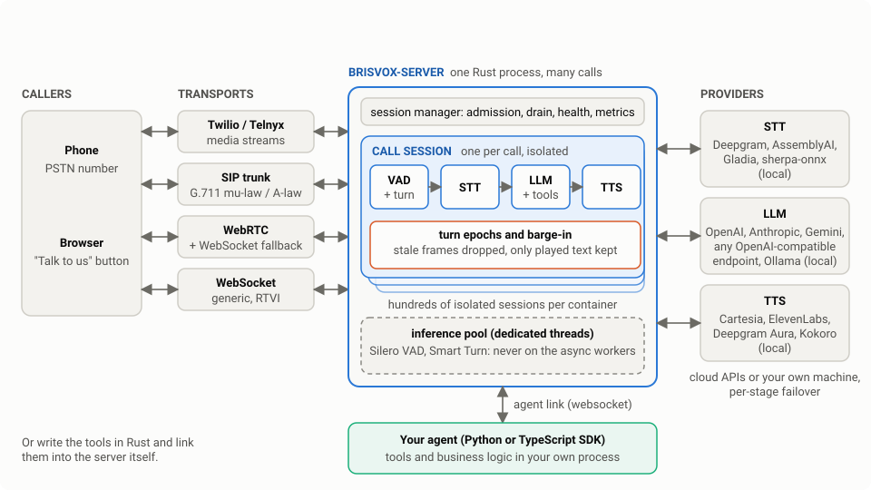
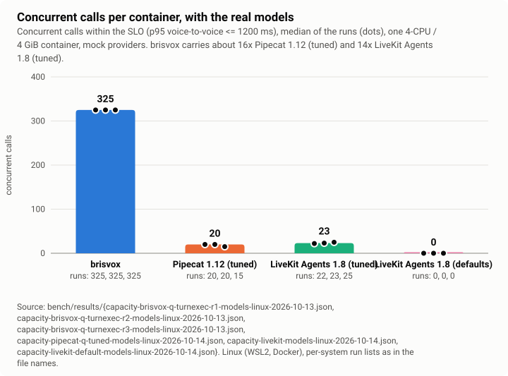
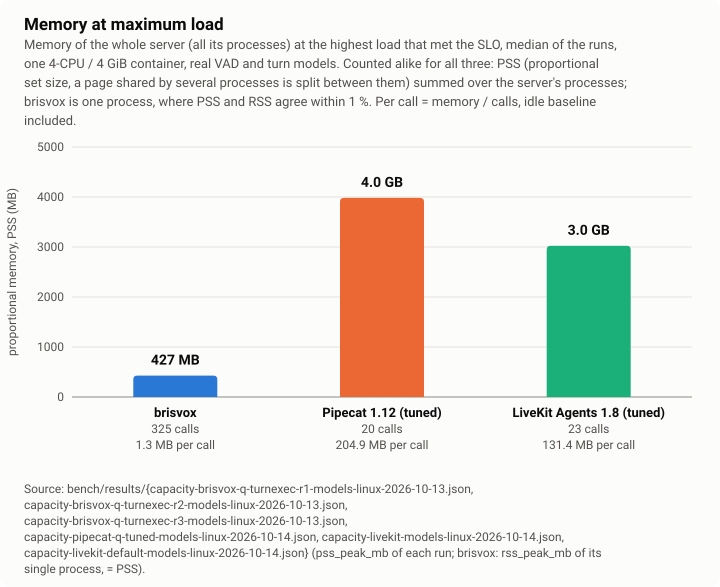
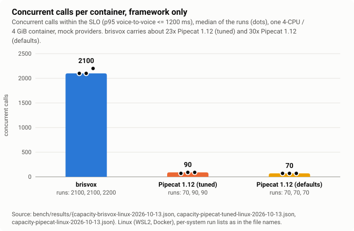
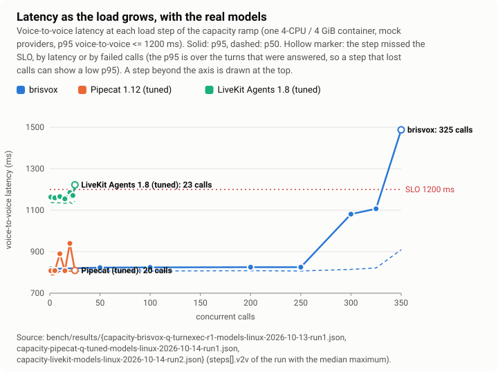
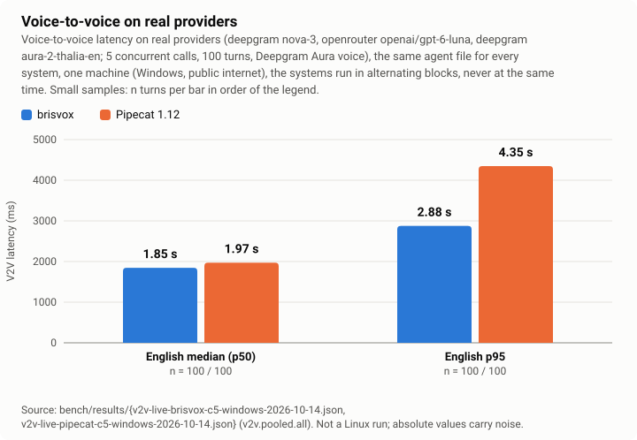
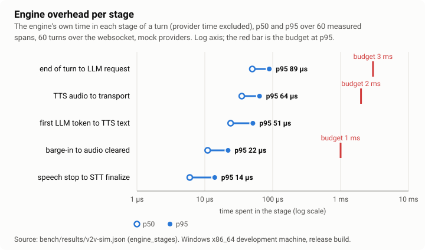

# brisvox

**A Rust engine for real-time voice agents: phone calls and browser sessions where a caller talks,
the agent listens, thinks (an LLM, with tools) and answers, and the caller can interrupt at any
moment. Open source, one process, hundreds of isolated calls per container.**

<p align="center"></p>

[Quickstart](#quickstart) · [Comparison](#brisvox-vs-livekit-agents-vs-pipecat) ·
[Features](#features) · [For AI coding agents](#for-ai-coding-agents) ·
[Docs: the book](book/src/introduction.md) · [License](#license)

## Why brisvox

Built to beat Pipecat on three axes with the same speech and language providers: latency, density
and correctness.

- **Density.** With the real Silero VAD and Smart Turn models running on every call, one 4-CPU /
  4 GiB container carried **325 concurrent calls** within the latency SLO against **23** for
  LiveKit Agents 1.8 (tuned; its defaults passed none) and **20** for Pipecat 1.12.0, each with
  its own VAD and turn model: about **14 to 16 times** the calls in this harness, with much less
  memory at the maximum (about 430 MB against about 3 GB and 4 GB; how each was counted is under
  "How to read the numbers"). Each call is an isolated session; a panic or a provider failure in
  one cannot touch another.
- **Latency.** The engine's own added time is tens of microseconds per stage (0.089 ms at p95 from
  end of turn to the LLM request, budget 3 ms). On real providers (Deepgram, OpenRouter pinned to
  one upstream, Deepgram Aura voice), 5 concurrent calls, 100 turns per system, the median
  voice-to-voice was **1.85 s against 1.97 s** for Pipecat and the p95 **2.88 s against 4.35 s**.
  The STT final arrived earlier through brisvox (its `Finalize` runs at the VAD stop instead of
  waiting for the provider's own endpointing; the two systems' timers are not measured from the
  same point, so this is not a share of the gap); the LLM's first token took about the same time on
  both. Pipecat sent more than one LLM request in 56 of 100 turns (mostly the first turn of a call),
  which is where its tail comes from; the cause was not investigated (it is consistent with a turn
  ended at a pause inside the utterance). An earlier run with Cartesia,
  one call at a time and 30 turns, gave 1.69 s against 2.03 s. Connections
  are prewarmed, the LLM can start speculatively, and the first clause of the answer goes to the
  voice after one word.
- **Correctness.** Every user turn is a numbered epoch and stale frames are dropped everywhere;
  after a barge-in the LLM context holds only the text that was actually played; side-effect tools
  never run speculatively and never run twice for one call id (and an identical repeat in the
  same turn is refused). The exact scope, and the idempotency key to add for "once per order,
  ever", is in [`docs/TOOLS.md`](docs/TOOLS.md#what-never-twice-covers). All of it is proven by
  deterministic, paused-clock simulation.

### Capacity

<p align="center"></p>

The same container, the same SLO (p95 voice-to-voice at most 1200 ms), mock providers so that only
the framework and its models are measured, three runs each. Pipecat (four worker processes, the
models loaded in each) is memory-bound: its workers are killed at the 4 GiB limit around 25 calls.
LiveKit Agents (one process per call) stopped with headroom left (about 2.1 of 4 cores, about 3 of
4 GiB): the failing steps were calls that got no agent within 10 s when a whole round of calls
started at once, so 23 is a lower bound under this arrival pattern, not a resource ceiling (an
unverified explanation; LiveKit's own test ran 30 agents on 4 cores). Its media also crosses a
LiveKit server (the SFU, outside the 4-CPU budget) and its one-call latency sits about 180 ms over
the others' floor, leaving it less of the SLO's margin. With its default settings LiveKit Agents
passed no step at all: its turn detector scored the benchmark's utterances just under its
end-of-turn threshold and waited its 2.5 s maximum delay on about 45 % of turns, so even one call
missed the SLO. The tuned run lowers that threshold (the model still runs on every turn) and is
the number shown ([methodology](bench/livekit_baseline/README.md)).

<p align="center"></p>

Without the models (an energy VAD and a fixed Smart Turn answer) the framework cost alone is:

<p align="center"></p>

<p align="center"></p>

Latency stays flat until a system runs out of CPU or memory, then crosses the SLO within a step or
two: the number that matters is where that happens
([framework-only version](assets/charts/latency-vs-calls-framework.svg)).

### Latency

<p align="center"></p>

Both systems ran the same agent file against the same real providers and models (Deepgram nova-3,
OpenRouter `openai/gpt-6-luna` with reasoning effort `none`, pinned to OpenRouter's `openai`
upstream without fallbacks and checked on every response that streamed (Pipecat's cancelled
requests never reported one), Deepgram Aura `aura-2-thalia-en`), with 5
concurrent calls, 10 blocks of 10 turns per system, strictly alternating (b1 p1 b2 p2 ...), so both
saw the same provider conditions. The LLM provider's own variance is still as large as the median
difference (126 ms): the LLM first token is 931 ms for brisvox and 889 ms for Pipecat at p50. The
tail differs more than the median because Pipecat sent a second or third LLM request in about half
of the turns here (one call at a time it was 5 of 30). One setting is not equal: the same nominal
100 ms silence before the VAD stop is 3 Silero windows (96 ms) in Pipecat and 4 (128 ms) in
brisvox, so Pipecat decides about 32 ms earlier at every turn end (faster when the turn really
ended, and a candidate for its extra mid-utterance turn ends); the breakdown by stage, the routing
check, this mismatch and the
earlier Cartesia runs are in the "Live comparison with real providers" section of
[`docs/LATENCY.md`](docs/LATENCY.md).

<p align="center"></p>

### How to read the numbers

- **Capacity and memory** are **Linux** runs (WSL2, kernel 6.6, Docker) in equal `--cpus=4
  --memory=4g` containers, 2026-10-13 (brisvox, Pipecat) and 2026-10-14 (LiveKit Agents), release
  builds, one system at a time (never two at once, so they never share the CPU), over **mock
  providers** with the same latencies for all three systems
  (STT final 150 ms, LLM first token 350 ms, TTS first byte 150 ms). They say how much the
  framework and its models cost, not what a deployment with real STT, LLM and TTS carries. The
  Pipecat side is `bench/pipecat_baseline`: a Pipecat 1.12.0 bot speaking the same websocket
  protocol, measured by the same client with the same definition of voice-to-voice. The LiveKit
  side is `bench/livekit_baseline`: a LiveKit Agents 1.8.7 worker with the same mock latencies,
  measured by a LiveKit room client with the same fixtures and definition, searched to a 2-call
  resolution (the others used coarser steps, which slightly favours LiveKit). brisvox's 325 is the
  quiet-host rerun of its final build; runs of the same day on a busy host gave 125 to 250
  (`docs/LATENCY.md`, "Capacity with the models").
- **Memory is counted the same way for all three: PSS** (proportional set size, read from
  `/proc/<pid>/smaps_rollup`: a page shared by several processes is split between them), summed
  over every process of the server. A plain RSS sum counts shared pages once per process: it
  overstates Pipecat by about 4 % (4.34 GB RSS vs 4.19 GB PSS at 20 calls) and LiveKit by a
  factor of 6 (18 GB vs 2.9 GB at 22 calls: its job processes are forked from a parent that
  preloaded the models). brisvox is one process, where the two agree (432 MB RSS, 429 MB PSS at
  350 calls in the 2026-10-14 cross-check). Pipecat was re-measured for this on 2026-10-14
  (3 runs, same steps, container and mocks: 20, 20, 15 calls, median 20, as on 2026-10-13 with
  20, 15, 20).
- **Live voice-to-voice** is **Windows** on a shared development machine over the public internet,
  one evening (100 turns per system, 5 concurrent calls, alternating blocks; Cartesia's plan allows
  only 2 concurrent generations, hence the Aura voice); absolute numbers carry noise. **Engine overhead** is the Windows run over mocks.
- Every number is in a committed file under [`bench/results/`](bench/results/README.md) (the file
  starts with the command that produced it); the charts are generated from those files by
  `python3 scripts/gen_charts.py` and checked for staleness by the quality gate. Definitions and
  more results (load simulation, speculation, Windows capacity): the book's
  [Benchmark results](book/src/benchmarks.md) and [`docs/LATENCY.md`](docs/LATENCY.md).

## brisvox vs LiveKit Agents vs Pipecat

Two kinds of rows. **Measured** rows come from this repository's own benchmark harness (files named
in the last column; the table is generated from them); "not measured" means this repository has
no such run for that system yet. LiveKit Agents runs over its own WebRTC SFU (a LiveKit server in
a separate container, not counted in the 4-CPU budget: about 0.45 cores and 290 MB at the maximum,
reported in `bench/results/capacity-livekit-sfu-2026-10-14.md`); the other two run over a
websocket. **Documented** rows are what each project's own documentation and
repository say, fetched 2026-10-14, not benchmarks; the bracketed tags are source ids listed in
[`docs/research/frameworks-2026-10-14.md`](docs/research/frameworks-2026-10-14.md), where every
fact carries its URL and what is inferred or not stated is marked as such.

<!-- measured:begin (generated by scripts/gen_charts.py from bench/results; do not edit) -->

| Measured here | brisvox | LiveKit Agents | Pipecat 1.12 | Source |
|---|---|---|---|---|
| Concurrent calls within the latency SLO, **real VAD and turn-detection models on every call** (Silero + Smart Turn; LiveKit: Silero + its own turn detector), one 4-CPU / 4 GiB container, mock providers (median, runs in brackets) | **325** (325, 325, 325) | **23** (22, 23, 25) tuned; **0** (0, 0, 0) defaults | **20** (20, 20, 15) | `bench/results/capacity-*-models-linux-*` |
| Concurrent calls, **framework only** (energy VAD, fixed turn answer), same 4-CPU / 4 GiB container | **2100** (2100, 2100, 2200) | not measured | **90** (70, 90, 90) tuned; **70** (70, 70, 70) defaults | `bench/results/capacity-*-linux-*` |
| Memory at that maximum (real models; PSS summed over the server's processes for all three; brisvox is one process, PSS = RSS) | 427 MB at 325 calls | 3.0 GB at 23 calls tuned | 4.0 GB at 20 calls | same files |
| Voice-to-voice on real providers, English, p50 / p95 (5 concurrent calls, 100 turns, Deepgram Aura voice; Windows, public internet) | 1.85 s / 2.88 s (100 turns) | not measured | 1.97 s / 4.35 s (100 turns) | `bench/results/v2v-live-*-windows-*` |

<!-- measured:end -->

| Documented (2026-10-14) | brisvox | LiveKit Agents | Pipecat |
|---|---|---|---|
| Language | Rust engine; your agent in Python or TypeScript (SDKs, not published to PyPI or npm yet) or in Rust | Python (`livekit-agents` 1.8.7); Node.js in a separate repo [L2][L5] | Python (`pipecat-ai` 1.12.0) [P2][P4] |
| License | Apache-2.0 or MIT | Apache-2.0; the turn-detector text model and `v1-mini` use the LiveKit Model License [L6][L8] | BSD-2-Clause [P3] |
| Runtime model | one process, one isolated async session per call, models on a dedicated thread pool | one OS process per job, "each in its own process for isolation" [L7] | documented as one session per process or container [P5] |
| Needs a media server | no: WebSocket, Twilio and Telnyx built in; WebRTC and SIP are cargo features | yes: a LiveKit server (Cloud or self-hosted), the agent joins a room [L6] | no for WebSocket and SmallWebRTC; the Daily and LiveKit transports use those vendors' infrastructure [P7] |
| Telephony | Twilio and Telnyx media streams, SIP trunk listener, DTMF, transfer | LiveKit SIP service: Twilio, Telnyx, Plivo and others, DTMF, cold and warm transfer [L12] | Twilio, Telnyx, Plivo, Exotel serializers [P7]; no SIP stack of its own found in the pages read (inferred) |
| Turn detection | Smart Turn v3.2 (ONNX, on device) with an adaptive policy | own turn-detector models: a text model (396 MB on disk, about 50-160 ms per turn on CPU) and the audio model `v1-mini` (the one the capacity run used; its size and cost are not stated) [L8] | Smart Turn v3 (8 MB int8) [P8][P10] |
| Turkish | first class ([`docs/TURKISH.md`](docs/TURKISH.md)) | listed by both turn detectors [L8] | listed by Smart Turn [P10] |
| Interruptions | turn epochs; context keeps only the text actually played | adaptive mode separates interruptions from backchannel, resumes after a false one [L13] | cancels LLM and TTS, flushes audio, commits only the played text; a minimum-words turn-start strategy and a Krisp backchannel filter [P12] |
| Tools | `read_only` / `side_effect` kinds, idempotency keys, never speculative; written in Rust, Python or TypeScript | function tools, async tools, handoff, MCP (Python), provider-side tools; parallel calls not stated on the page read [L15] | parallel calls by default, async tools, per-tool timeouts, cancel on interruption; MCP not checked [P13] |
| Speech-to-speech | OpenAI Realtime, Gemini Live | many realtime models [L16] | several [P4] |
| Overload handling | admission control and graceful drain built in | default load function (5 s average CPU, threshold 0.7) [L11][L17] | none found in the docs; autoscaling guidance [P5] |
| Hosted cloud | none, self-host only | optional LiveKit Cloud [L6] | optional Pipecat Cloud [P5][P14] |
| Vendor sizing guidance | none, see the measured rows | 4 cores / 8 GB for 10-25 jobs; a vendor test of 30 agents peaked at about 3.8 cores and 2.8 GB [L11] | Pipecat Cloud profile of 0.5 vCPU / 1 GB per session [P6] |

None of this is an independent benchmark: no third-party density comparison of the three was found
([research notes](docs/research/frameworks-2026-10-14.md#3-independent-benchmarks-2025-2026)).

## Quickstart

Needs Rust (the toolchain is pinned in `rust-toolchain.toml`) and API keys for the example agent's
providers: Deepgram (STT), OpenAI (LLM) and Cartesia (TTS).

```sh
cargo build --release -p brisvox-server --features all-providers,smart-turn-ort,demo-tools
python3 scripts/models/fetch_models.py          # the Smart Turn model (pinned SHA-256)
export DEEPGRAM_API_KEY=...  OPENAI_API_KEY=...  CARTESIA_API_KEY=...
BRISVOX_AGENT_FILE=examples/agents/support-en.toml target/release/brisvox-server   # ws on :8080
# in another shell: play a recorded utterance at it and measure the answer time
cargo run --release -p brisvox-bench -- v2v --url ws://127.0.0.1:8080/ --fixtures en_two_utterances --runs 1
```

Your own tools and logic, in Python or TypeScript:

```python
from brisvox_agent import Agent

agent = Agent("luigi", system_prompt="You are Luigi's host.", greeting="Hi, Luigi's here!")

@agent.tool
async def opening_hours(day: str) -> str:
    """Opening hours of the restaurant on a weekday."""
    return "12:00 to 22:00"

agent.run(port=8765)    # server side: BRISVOX_AGENT_URL=ws://127.0.0.1:8765
```

Or with Docker: `cp deploy/ws.env.example deploy/ws.env`, fill in the keys, then
`docker compose -f deploy/compose.yaml up --build agent-ws`. More in the book:
[Quickstart](book/src/quickstart.md); fully local with no API key: [A fully local
assistant](book/src/quickstart/local.md).

## What you can build

The default build has no providers and no listeners beyond the websocket; you choose cargo
features for what you want to run. The same names go into the Docker image through the
`BRISVOX_FEATURES` build argument (default `all-providers,call-control,smart-turn-ort`, which has
**no `webrtc`**). `all-providers` can be replaced by the individual `provider-*` features to keep
the binary smaller.

| Goal | Cargo features (`--features`) | Docker `--build-arg BRISVOX_FEATURES=` | Read |
|---|---|---|---|
| A voice button on a website (browser, WebRTC with a WebSocket fallback) | `all-providers,smart-turn-ort,webrtc` | `all-providers,smart-turn-ort,webrtc` | [web assistant](examples/web-assistant), [hosting, incl. one-port platforms](docs/DEPLOY.md) (add `call-control` if the same server also takes phone calls) |
| A phone number through Twilio or Telnyx (transfer, DTMF, hang-up) | `all-providers,call-control,smart-turn-ort` | the default | [phone receptionist](examples/phone-receptionist), [Telephony](docs/TELEPHONY.md) |
| A SIP trunk | `all-providers,call-control,smart-turn-ort,sip` | `all-providers,call-control,smart-turn-ort,sip` | [Telephony](docs/TELEPHONY.md), [Deploying](docs/DEPLOY.md) |
| Fully local speech (sherpa-onnx, Ollama, Kokoro), no API key | `provider-sherpa-onnx,provider-openai-compatible,provider-openai-speech,smart-turn-ort,webrtc` | the same list | [A fully local assistant](book/src/quickstart/local.md) |
| Your own tools in Python or TypeScript | the features of the goal above; tools come from an SDK process | the same | [SDKs](sdk/python/README.md), [booking agent](examples/booking-agent) |
| Your own tools in Rust, in one binary | your crate depends on `brisvox-server` with the provider features your agent file names (and `smart-turn-ort`, `webrtc`, `call-control` as above) | build your own image from your crate | [Rust tools](examples/rust-tools), [Tools](docs/TOOLS.md) |

`smart-turn-ort` is the end-of-turn model: without it, and the model file from
`python3 scripts/models/fetch_models.py`, adaptive turns end at a 3 second fallback deadline.
Before you run anything, `target/release/brisvox-server check <agent-file> --require-secrets`
validates an agent file against the binary you built (providers compiled in, keys set, tools
known), offline, with line and column for every problem. Which provider and which model to pick
for your language and budget is a live test, not a table: the agent files in
[`examples/agents`](examples/agents) are the starting points.

## Features

- **Transports.** Generic websocket ([protocol](docs/WEBSOCKET_PROTOCOL.md)), Twilio Media
  Streams, Telnyx media streaming, RTVI (Pipecat's client SDKs), WebRTC (feature `webrtc`) and a
  SIP trunk listener (feature `sip`). G.711 mu-law and A-law, any call rate with any provider
  rate.
- **Providers.** STT: Deepgram, AssemblyAI, Gladia; on your own machine sherpa-onnx (CPU) or a
  server that speaks the OpenAI Realtime transcription protocol. LLM: OpenAI, Anthropic, Gemini,
  and any OpenAI-compatible endpoint (Groq, Together, Fireworks, vLLM, Ollama, OpenRouter:
  [recipe](docs/PROVIDERS.md)). TTS: Cartesia, ElevenLabs, Deepgram Aura; on your own machine any
  server of the OpenAI `/v1/audio/speech` shape (Kokoro-FastAPI, Chatterbox). Speech-to-speech:
  OpenAI Realtime and Gemini Live. On-device: Silero VAD and Smart Turn v3.2 end-of-turn detection. Per-stage
  failover, circuit breakers and retry budgets.
- **Conversation.** Adaptive turn taking, interruption policy with backchannel lists, speculative
  LLM start, played-text truncation, tool calls with `read_only` / `side_effect` kinds and
  idempotency keys, filler phrases for slow tools, DTMF in and out, call transfer, answering
  machine handling. English and Turkish supported.
- **SDKs and clients.** [Python](sdk/python/README.md) and [TypeScript](sdk/typescript/README.md)
  SDKs for an out-of-process agent: your tools and application logic in your own process, the
  server runs the call ([agent protocol](docs/AGENT_PROTOCOL.md)). [`@brisvox/web`](sdk/web/README.md)
  is one dependency-free ES module for a "Talk to us" button on a website: WebRTC first, an
  automatic WebSocket fallback on the same port, microphone, playback, barge-in and clean hang-up.
- **Config.** One TOML or YAML file per agent ([reference](docs/CONFIG.md));
  `brisvox-server check <file>` validates a file offline, with line and column for every problem,
  before you deploy it. `brisvox_server::app::run_with_tools(Arc::new(MyTools))` is a whole `main`
  for a server with your own Rust tools ([guide](docs/TOOLS.md), [example](examples/rust-tools)).
- **Operations.** Health and readiness endpoints, Prometheus metrics, OpenTelemetry traces
  (feature `otlp`), admission control, graceful drain, a container image and compose file.
- **Examples.** [Phone receptionist](examples/phone-receptionist), [web
  assistant](examples/web-assistant), [booking agent](examples/booking-agent) (Python SDK tools),
  [Rust tools](examples/rust-tools), plus single-file agent definitions in
  [`examples/agents`](examples/agents).

## For AI coding agents

brisvox is written to be picked up by an AI coding agent (Claude Code, Codex, Cursor and the like)
with no prior knowledge:

- [`llms.txt`](llms.txt) is the map ([llmstxt.org](https://llmstxt.org) format): the facts to know
  before writing anything and one line per document saying when to read it.
  [`llms-full.txt`](llms-full.txt) is the user guide in one file. Both are generated from the docs
  (`scripts/gen_llms.py`) and checked for staleness by the quality gate.
- [`skills/brisvox`](skills/brisvox/SKILL.md) is an Agent Skill with the workflow and the common
  traps. For Claude Code, copy the folder into your project's `.claude/skills/` (or
  `~/.claude/skills/`); other agents can be pointed at the file.
- `brisvox-server check <agent-file>` validates an agent file offline with the real loader, so an
  agent finds its own mistakes (key path and line for each) before anything runs.
- [`docs/agent.schema.json`](docs/agent.schema.json) is the JSON Schema of the agent file for
  editors and tools (`brisvox-server --print-schema`; setup in `docs/CONFIG.md`).

## Documentation

The book in [`book/`](book) organises the design and reference documents in [`docs/`](docs)
(included, not copied: one source of truth) into chapters: introduction, quickstart, concepts
(pipeline, turns and interruptions, played-text truncation, tools), configuration, telephony,
operations, benchmarks and reference (protocols, providers).

```sh
cargo install mdbook        # once
mdbook serve book --open    # or: mdbook build book  (output in target/book)
python3 scripts/check_book.py   # structure check without mdbook: links, includes, every doc included
```

Entry points: [`docs/ARCHITECTURE.md`](docs/ARCHITECTURE.md) (design),
[`docs/PIPELINE.md`](docs/PIPELINE.md) (the production pipeline),
[`docs/LATENCY.md`](docs/LATENCY.md) (latency budget and measurements),
[`docs/OPERATIONS.md`](docs/OPERATIONS.md) (running the server),
[`docs/TESTING.md`](docs/TESTING.md) (how it is proven),
[`bench/results/README.md`](bench/results/README.md) (the benchmark harness and every result file).

## Layout

| Crate | Purpose |
|---|---|
| `brisvox-core` | frames, processors, pipeline, clock, turn epochs |
| `brisvox-audio` | codecs, resampling, buffers, output pacing |
| `brisvox-inference` | dedicated CPU pool, on-device models (VAD, turn detection) |
| `brisvox-agent` | turn taking, interruptions, context, tools, TTS segmentation |
| `brisvox-engine` | the production voice pipeline (one session per call) |
| `brisvox-providers` | STT / LLM / TTS traits and adapters |
| `brisvox-transport` | websocket, telephony, WebRTC transports |
| `brisvox-agent-link` | the out-of-process agent protocol |
| `brisvox-server` | multi-tenant session server (binary + library) |
| `brisvox-sim` | mock providers and deterministic simulator |
| `brisvox-bench` | benchmark harness (binary) |

## Building and testing

```bash
cargo build --workspace
scripts/verify.sh        # fmt + clippy (-D warnings) + docs + tests + SDKs + examples + book check
```

Library code may not `unwrap`, `expect`, `panic!`, `todo!` or index in a way that can panic;
these lints are denied workspace-wide and relaxed only inside tests (`clippy.toml`).

## License

Licensed under either of

- Apache License, Version 2.0 ([LICENSE-APACHE](LICENSE-APACHE))
- MIT license ([LICENSE-MIT](LICENSE-MIT))

at your option.

Exception: the speech test fixtures in `fixtures/` (audio and transcripts from Google FLEURS /
FLORES) are not covered by the code license; they are shared under CC BY-SA 4.0, see
[`fixtures/NOTICE`](fixtures/NOTICE).

Unless you explicitly state otherwise, any contribution intentionally submitted for inclusion
in the work by you, as defined in the Apache-2.0 license, shall be dual licensed as above,
without any additional terms or conditions.
